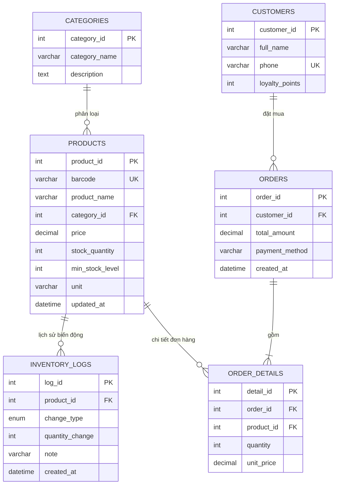
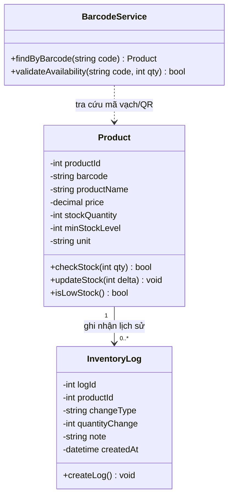

# Module 3: Quản lý Kho hàng & Nhận diện Barcode/QR (Thành viên 3)

## 1. Phạm vi nhiệm vụ & Mục tiêu đề tài
- Quản lý tồn kho sản phẩm: cập nhật số lượng tồn kho (nhập thêm, điều chỉnh kiểm kê) và tự động cảnh báo hàng sắp hết / hết hàng.
- Nhận diện sản phẩm tự động qua mã **Barcode / QR Code** (nhập mã, dùng máy quét cầm tay hoặc quét bằng camera) để đưa vào giỏ hàng.
- Tham gia luồng nghiệp vụ bán lẻ: **chọn hàng → kiểm tra tồn → lập đơn → thanh toán → cập nhật tồn (trả về tồn kho mới)**.
- Tài liệu bàn giao: **ERD**, **Class Diagram**, **Thiết kế CSDL** và **script dữ liệu mẫu**.

## 2. Sơ đồ ERD (Entity-Relationship Diagram)



## 3. Sơ đồ Lớp (Class Diagram)



## 4. Quy tắc nghiệp vụ cốt lõi của Module Kho
1. **Cảnh báo hàng sắp hết / hết hàng:** Khi `stock_quantity = 0` → trạng thái `OUT_OF_STOCK` (Hết hàng); khi `0 < stock_quantity <= min_stock_level` → trạng thái `LOW_STOCK` (Sắp hết) và hiển thị trong danh sách cảnh báo.
2. **Nhận diện Barcode/QR:** Tìm chính xác theo `barcode` (UNIQUE). Nếu mã không tồn tại hoặc `stock_quantity <= 0` thì từ chối thêm vào giỏ và báo lỗi rõ ràng.
3. **Kiểm tra tồn & Cập nhật tồn mới:** Trước khi chốt đơn/thanh toán, kiểm tra đủ số lượng tồn; sau khi thanh toán thành công, trừ tồn kho bằng transaction, ghi log `EXPORT` và trả về `new_stock` (tồn kho mới).

## 5. Hướng dẫn cài đặt & chạy thử
1. Chạy file `database.sql` trên MySQL để tạo CSDL `pos_system` và dữ liệu mẫu.
2. Cập nhật thông tin kết nối MySQL (nếu cần) trong `server.js`.
3. Chạy lệnh:
   ```bash
   npm install
   npm start
   ```
4. Truy cập `http://localhost:3000`.
